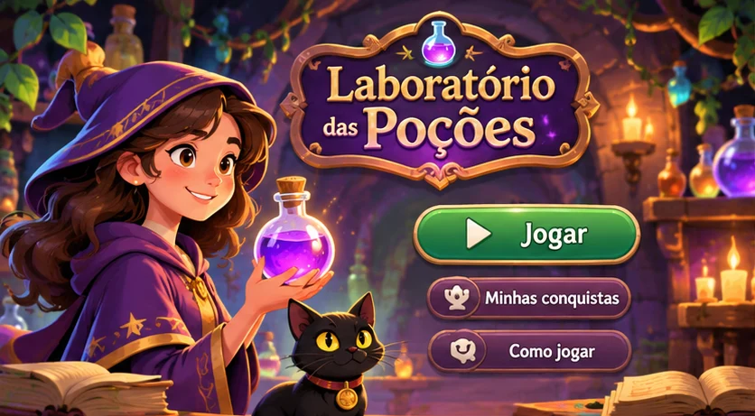
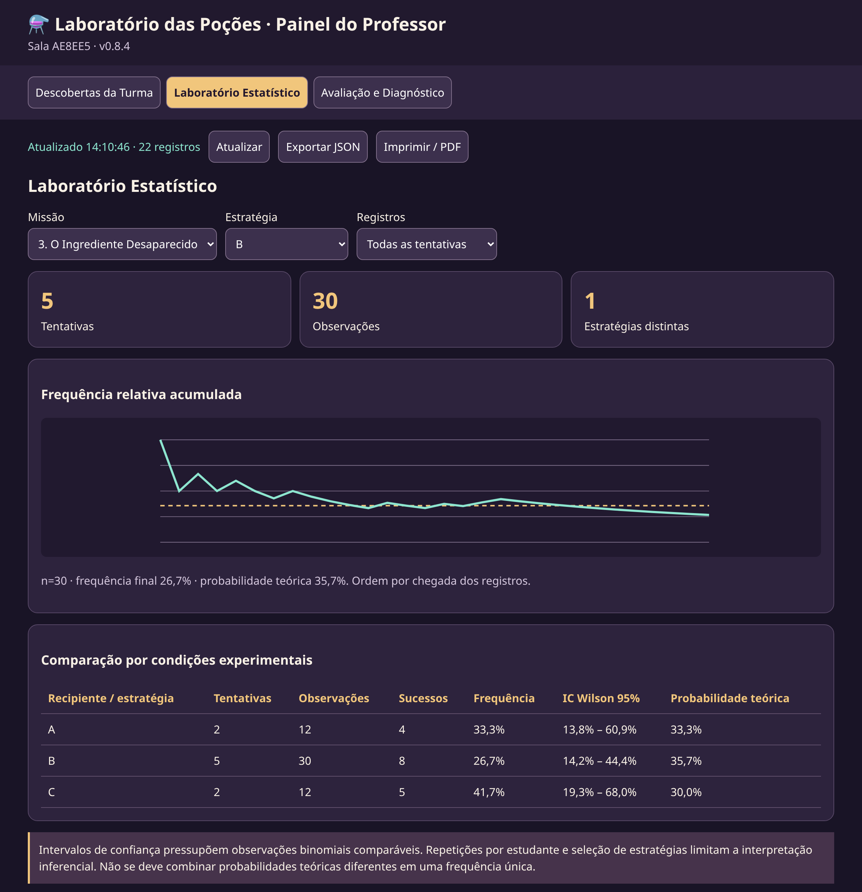
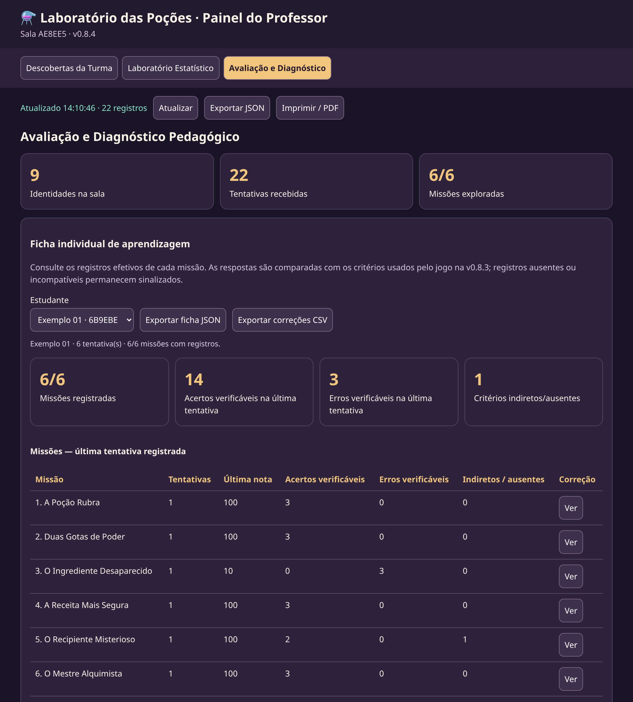
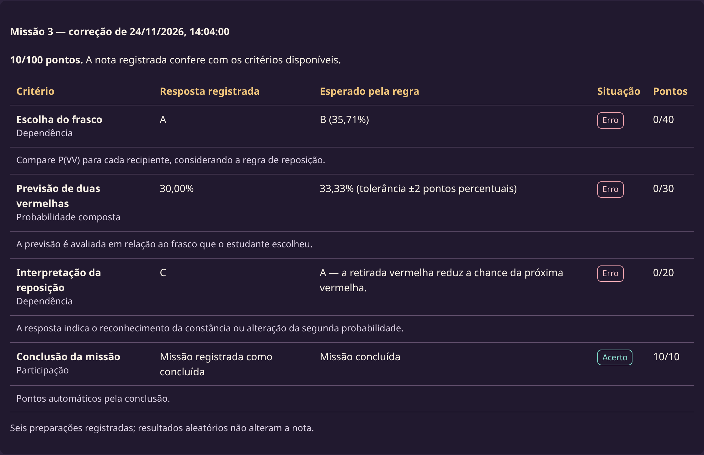

# Laboratório das Poções


**Autor:** Renato Dutra Pereira Filho — desenvolvimento assistido por ChatGPT (OpenAI), por meio de *vibe coding*.



Recurso educacional digital para o ensino de Probabilidade e Estatística, com seis missões investigativas, simulações de experimentos aleatórios e painel de acompanhamento docente. A proposta foi concebida para o 9º ano do Ensino Fundamental e pode ser adaptada ao Ensino Médio.

**Versão deste repositório: 0.8.4 — edição completa.** A interface dos estudantes preserva a versão 0.8.3, conforme o histórico original; o painel docente é da versão 0.8.4. A versão individual 0.8.5 não foi incorporada a esta distribuição.

## Objetivos educacionais

- Relacionar probabilidades teóricas e frequências experimentais.
- Reconhecer eventos dependentes e independentes em retiradas sucessivas.
- Investigar a variabilidade de resultados e comparar estratégias.
- Argumentar a partir de dados e distinguir decisões fundamentadas de resultados aleatórios.

A habilidade EF09MA20 da BNCC constitui o eixo central da proposta. No Ensino Médio, a atividade pode ser articulada às habilidades EM13MAT310, EM13MAT311 e EM13MAT312, mediante planejamento docente.

## As seis missões

| Missão | Conteúdo principal |
| --- | --- |
| 1 — A Poção Rubra | Probabilidade simples e frequência observada |
| 2 — Duas Gotas de Poder | Retiradas com reposição e independência |
| 3 — O Ingrediente Desaparecido | Retiradas sem reposição e dependência |
| 4 — A Receita Mais Segura | Comparação de estratégias |
| 5 — O Recipiente Misterioso | Estimativa de probabilidade e variabilidade amostral |
| 6 — O Mestre Alquimista | Eventos compostos e decisões sob restrições |

## Como utilizar

### Modo individual — sem servidor

Baixe ou clone o repositório, extraia os arquivos quando necessário e abra `ABRIR_OFFLINE.html` em um navegador. Não é necessário instalar Python nem criar conta. Este modo não envia resultados a um painel de turma.

O arquivo `index.html` e seus módulos também permitem publicar a interface individual em uma hospedagem estática, como GitHub Pages. O modo coletivo não funciona apenas com GitHub Pages: requer o servidor Python em funcionamento. A instalação como PWA depende do navegador e do contexto seguro; não é garantida em HTTP na rede local.

### Modo coletivo — computador do professor

Com Python 3.10 ou superior instalado, abra um terminal na raiz do repositório. No Miniforge, por exemplo:

```bash
conda create -n labprob python=3.11
conda activate labprob
python -m pip install -r servidor/requirements.txt
python iniciar_aula.py --turma 91
```

O endereço administrativo aparece no terminal. Abra o painel do professor e compartilhe somente o endereço ou QR Code destinado aos estudantes. Os celulares precisam conseguir acessar o computador do professor pela rede local; confira as permissões de rede e firewall conforme as regras da instituição. A porta padrão é 8765. Encerre com Ctrl+C.

O arquivo `INICIAR_AULA.bat` é uma opção no Windows após instalar as dependências no ambiente Python utilizado.

## Painel do professor

O painel reúne três abas: Descobertas da Turma, Laboratório Estatístico e Avaliação e Diagnóstico. Permite consultar frequências por estratégia, intervalos de Wilson, fichas individuais, critérios de correção, histórico e registros docentes.

**Laboratório Estatístico**



**Avaliação e Diagnóstico**



**Correção detalhada de uma missão**



*Capturas da interface original v0.8.4, com dados fictícios e transporte demonstrativo da API. Não representam resultados de aplicação escolar.*

## Estrutura do projeto

- `ABRIR_OFFLINE.html`: distribuição individual autocontida.
- `index.html`, `style.css`, `*.js`, `assets/`: interface modular, lógica das missões e comunicação coletiva.
- `servidor/`: servidor FastAPI, painel docente, persistência SQLite e diagnóstico.
- `iniciar_aula.py`, `INICIAR_AULA.bat`: inicialização local.
- `tests/`: testes computacionais.
- `README_V082.md`, `README_V083.md`, `README_V084.md`: notas originais das versões.
- `README_PAINEL_PROFESSOR.md`: instruções e limites do painel.
- `docs/`: documentação complementar e capturas demonstrativas.

## Testes e desenvolvimento

```bash
python -m pip install -r servidor/requirements.txt -r requirements-dev.txt
python -m pytest -q
```

Com Node.js instalado, execute os sete arquivos `tests/test_*.js` individualmente (por exemplo, `node tests/test_math.js`). Em Bash, é possível executar todos com:

```bash
for f in tests/test_*.js; do node "$f" || exit 1; done
```

A preparação deste pacote, em 24/11/2026, verificou cinco testes Python e sete scripts JavaScript, todos concluídos com sucesso. Isso não equivale a uma auditoria independente nem à validação em sala de aula. Consulte [o registro de preparação](docs/VERIFICACAO.md) e as notas originais.

## Privacidade e limitações

Não publique bancos de turmas, arquivos de estado, chaves administrativas, exportações de estudantes ou observações pedagógicas. O servidor destina-se à rede local, utiliza HTTP e não deve ser exposto diretamente à internet. Pseudônimos não asseguram anonimização. Os diagnósticos são indícios pedagógicos, não classificações definitivas de aprendizagem. A Missão 5 não registra a composição oculta do recipiente, limitando a reconstrução posterior de sua estimativa.

A eficácia pedagógica requer avaliação empírica. Os testes em rede escolar, dispositivos reais e tecnologias assistivas não são substituídos pelos testes automatizados.

## Uso de inteligência artificial

O desenvolvimento empregou programação assistida por IA generativa (*vibe coding*), mediante especificação em linguagem natural, geração incremental, revisão e testes de código. A concepção educacional, as decisões de desenvolvimento e a responsabilidade pela avaliação permanecem humanas. Ver [declaração de transparência](docs/USO_DE_IA.md).

## Autoria e licença

**Autor do software:** Renato Dutra Pereira Filho (Universidade Federal do Rio Grande — FURG).

O software foi concebido e desenvolvido pelo autor com auxílio do ChatGPT (OpenAI), por meio de *vibe coding*. A ferramenta de IA não figura como autora ou titular de direitos autorais. A autoria do software é distinta da autoria de eventuais trabalhos acadêmicos que o utilizem.

Copyright (c) 2026, Renato Dutra Pereira Filho. Distribuído sob a licença [BSD 3-Clause](LICENSE). As dependências de terceiros permanecem sujeitas às suas respectivas licenças. A referência à instituição identifica a afiliação do autor e não implica endosso institucional.

### Como citar

PEREIRA FILHO, Renato Dutra. **Laboratório das Poções**: recurso educacional digital para o ensino de Probabilidade e Estatística. Versão 0.8.4. 2026. Software.

Os metadados bibliográficos estão disponíveis em [CITATION.cff](CITATION.cff). Após a publicação, acrescente o endereço do repositório e a data de acesso à referência, quando aplicável.
